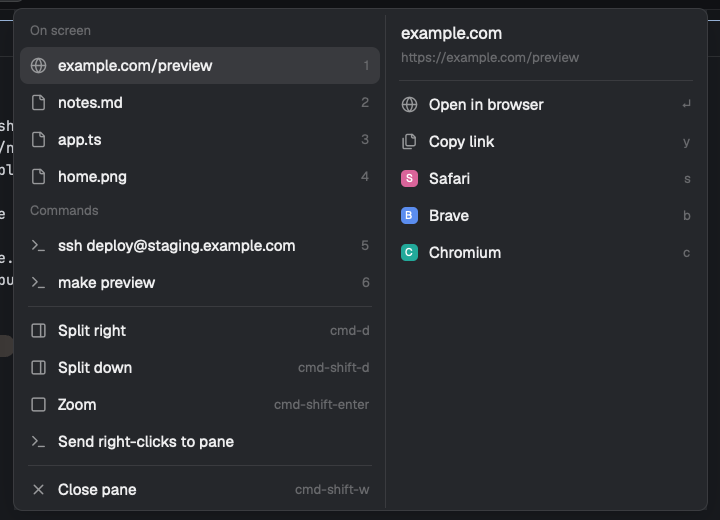
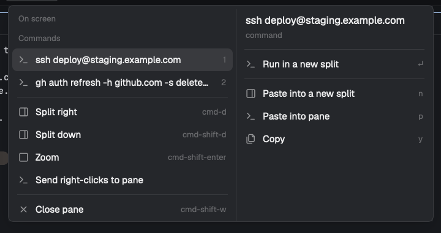

# Open paths and links

A [Herdr](https://herdr.dev) mod. Open what your terminal just printed, without leaving the keyboard.

Press `Cmd+Shift+O`. The files, folders, web links and commands on the terminal's screen are
listed and numbered, newest first. Press a number to pick one, then a letter for what to do
with it:

| Key | Does |
|---|---|
| `Enter` | opens it with its app, a link in your default browser, or runs a command in a new terminal beside the pane |
| `o` | reveals it in Finder |
| `y` | copies the path, the link, or the command |
| `n` | pastes a command into a new split beside the pane, without running it |
| `p` | pastes a command into the pane, without running it |
| `z` `x` `c` … | opens it in that editor: Zed, Xcode, Cursor, VS Code, the JetBrains IDEs, … |
| `v` | opens it in Neovim (or Vim), in a split beside the pane |
| `s` `b` `f` … | opens a link in that browser: Safari, Brave, Firefox, Chrome, Arc, … |
| `Esc` | closes |

So `Cmd+Shift+O` `1` `z` opens the first path in Zed, and `Cmd+Shift+O` `4` `Enter` runs
the `ssh` or login command an agent just asked you to run outside its session, in a fresh
terminal beside it that stays open as your shell. The first entry is already selected, so
`Cmd+Shift+O` `z` opens it in Zed straight away. Only editors and browsers installed on your Mac are
listed, and every letter is yours to change in `config.json`.

With the mouse: right-click the terminal. The same list sits at the top of Herdr's menu.
Hover a row to see its actions beside it, click one. With nothing on screen the menu is
Herdr's, unchanged.



A command an agent asked you to run elsewhere: Enter runs it in a fresh terminal beside the pane.



## Install

Ask the agent running in Herdr:

```text
Read ~/.config/herdr-app/AGENTS.md, then add this mod: https://github.com/kerembakir/herdr-mods/tree/main/on-screen
```

By hand: copy `mods/on-screen/` to `~/.config/herdr-app/mods/on-screen/`, merge `keys.json`
into yours (`"cmd-shift-o": "mod.open:on-screen"` under `global`), and on a personal layout
(Herdr's shipped layouts are read-only, so clone one first:
`herdr-app do layout.clone '{"name":"main","as":"main-plus"}'`) set the root field
`"terminal_menu": "on-screen"`. Then `herdr-app check ~/.config/herdr-app/mods/on-screen`.

## Use

- The list holds up to nine rows. Paths and links first: absolute, `~/` and relative paths, names with
  spaces, paths wrapped onto the next line, `file.ts:12:3` and `file.md#L4` references, bare
  file names found in the project below the pane's folder, and `http(s)://` links. Only paths
  that exist are shown, and by default only ones under your home: the scratch folders
  agents use under `/tmp` stay out. Under them, up to three commands: a `$ ` or `! ` line, a
  line inside a ``` fence, or an indented line that reads like a command (how agents print
  the commands they hand you): it starts with something your shell can run, does not end
  like a sentence, and starts with a known tool (`git`, `gh`, `npm`, `brew`, `ssh`, …) or
  carries a flag, a path, `&&`, `|`, `=` or `@`.
- ↑/↓ and hover also move the selection; Enter on one of Herdr's own items runs it.
- `mods/on-screen/config.json` is the settings file; save to apply.
  - `paths.home_only` (default `true`): list only paths under your home. `paths.ignore`:
    folders never listed, `/tmp`, `/private/tmp`, `~/Library`, `~/.cache`, `~/.Trash` by
    default.
  - `commands.enter`: what Enter does on a command, `run-split` (default), `paste-split`,
    `paste` or `copy`.
  - `letters`: one character per action (`reveal`, `copy`, `paste`, `paste-split`,
    `run-split`), editor id or browser id. Two entries on one letter: the first one
    installed, in catalog order, takes it (so `v` is Neovim when both Neovim and Vim are
    there).

[RECIPE.md](RECIPE.md) is the brief to build it from scratch.

## Privacy

No network requests. It reads the clicked terminal's visible screen through `hc read`, runs
one `sh` pass to see which of those words are files or folders, one to find the editors and
browsers installed, and `open` (or `xdg-open`, `explorer`) to launch things. Running a
command starts it in a new Herdr terminal (`sh -c`, then your login shell). Copy and paste
use the system clipboard. It writes nothing to disk. Terminals on other machines are not scanned.

## License

[Apache-2.0](../LICENSE). The icons it draws are Herdr's own and are not included here,
except `globe.svg` (Lucide, ISC). Attributions are in [NOTICE](../NOTICE) and
[licenses/](../licenses/).
