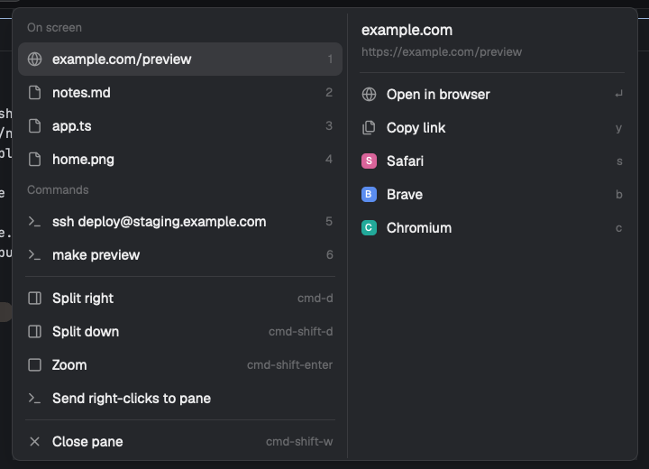

# Open paths and links

Open paths, links and commands straight from what the terminal printed, keyboard only.
Cmd+Shift+O lists every file path, folder, URL and command on the screen, numbered. A number
picks one, a letter acts: Enter opens the path in its app, the link in your browser, or runs
the command in a new terminal beside the pane. `o` reveals it in Finder, `y` copies it,
`z` `c` `v` open it in Zed, Cursor or Neovim. Right-click the terminal and the same list sits
at the top of Herdr's menu.



This file is the brief: enough to build the mod from an empty folder. The files next to it
are one build of it.

## What you see

- A popup on the theme's `popover` background, 5 px padding, 12.8 px text. Opened by a
  right-click it sits at the pointer; by Cmd+Shift+O at the top of the window, 40 px down.
  320 px wide with Herdr's items only; 414 px wide, two columns, once paths were found.
- **Left column** (215 px): a `dim` 11 px heading "On screen", then one 31 px row per path
  or link (8 px side padding, 9 px gap, radius 7): a 14 px `muted` icon (Herdr's
  `mods/files/file.svg` or `folder.svg`; a globe, `globe.svg` in this folder, for a link),
  the name (folders end in `/`, links show without `https://`, truncated), and its number
  1 to 9 on the right (11 px, `dim`). Then a "Commands" heading and up to three command
  rows (Herdr's `mods/workspace-chrome/terminal.svg`, the command text truncated, the next
  numbers). Nine rows at most in all. With commands only, the "On screen" heading is left out. The selected row has the `selected` background, a
  hover shows `hover`. A 1 px `border` line, 7 px in from the sides, then Herdr's pane
  items unchanged: Split right, Split down, Zoom, right-click routing, Close pane, with
  their key hints.
- A 1 px `border` line between the columns.
- **Right column** (180 px): a header with the selected entry's name (14 px, semibold;
  for a link its host) over its folder as `~/...` (11 px, `dim`; for a link the full URL),
  the full path as the tooltip. A line, then 31 px rows with the same look:
  - a path: "Open" with `↵`, "Reveal in Finder" ("Show in folder" off macOS) with `o`; a
    line; the GUI editors found here, each with its letter; an "In a split" heading (11 px,
    `dim`); the terminal editors (Neovim, Helix, Vim) with theirs. An editor's glyph is
    Herdr's shipped `icons/<id>.svg` (Cursor, Antigravity, Kiro, Neovim, Helix, Vim) or a
    14 px rounded tile in one of six colors with its first letter (9 px, bold, white).
  - a link: "Open in browser" with `↵`, "Copy link" with `y`; a line; the other browsers
    found here (Safari, Brave, Chrome, Chromium, Firefox, Arc, Edge, Zen, Vivaldi, Opera,
    Orion, DuckDuckGo, Tor Browser), each a tile with its letter.
  - a command: the header shows the command over the word "command"; the Enter row first
    ("Run in a split" by default, `↵`), a line, then the rest: "Paste in a split" `n`,
    "Paste in pane" `p`, "Copy" `y`.
  - a path also has "Copy path" with `y`, after Reveal.
  - A letter shows only on the first entry (catalog order) that has it, so with both
    Neovim and Vim installed `v` is Neovim and Vim shows no letter.
- No agent statuses, animations or timers.

## How it behaves

- Right-click a terminal, or press Cmd+Shift+O (`mod.open:on-screen`) with a terminal
  focused. The menu opens at once with Herdr's items, reads that terminal's screen, looks
  for the editors and browsers installed (once per Herdr session) and reads `config.json`;
  with paths found the right-click menu closes and reopens in place, two columns wide and
  as tall as its rows, while the key's menu grows in place. Cmd+Shift+O again closes it.
  Only terminals on this computer are scanned; with none focused, Cmd+Shift+O shows Herdr's
  global menu.
- Paths: words that start like `/x`, `~/`, `./`, `../`, `dir/` or a whole `name.ext`, after
  leading quotes, backticks or brackets; each start also tries up to six words (names with
  spaces) and, at a line end, the next line's first word (wrapped paths). Trailing prose
  punctuation and `:12`, `:12:3`, `#L4` suffixes are dropped. Relative paths resolve
  against the pane's folder; only paths that exist are listed, the longest candidate wins,
  duplicates, `/` and the pane's folder are skipped, and so is any path outside home when
  `paths.home_only` is on (default) or inside a `paths.ignore` folder. A bare `name.ext` not in the pane's
  folder is looked up below it (`git ls-files --cached --others --exclude-standard` in a
  work tree, else `find -maxdepth 6` skipping `.git` and `node_modules`; two matches per
  name, twelve names per menu). Links: `http://` or `https://` words, trailing punctuation
  dropped, no check. Order: lowest row first, right to left. Commands, after the paths: a
  line starting with `$ ` or `! ` (the rest), a non-empty line inside a ``` fence, or a line indented
  two or more spaces that reads like a command: it does not end with `.`, `,`, `;`, `:`, `!`
  or `?`; its first word is `sudo`, an executable file by path (`./build`, `~/bin/x`,
  `/usr/bin/y`, checked with `-x` against the pane's folder, so a wrapped `/pricing |` cell
  is not), or something the person's shell can run (`command -v` in their interactive login
  shell: programs, functions, aliases and builtins, not shell keywords like `in`, `for`,
  `time`); and, by name, it is a known tool (`git`, `gh`, `npm`, `brew`, `ssh`, `docker`,
  `make`, `cd`, …) or the line carries a flag, `/`, `&&`, `|`, `=`, `@`, `<`, `>` or `$`.
  So `  what finally went to eBay is the Reply.` is prose even though `/usr/bin/what` exists. A line ending in `\` joins
  the next. Lowest row first, duplicates dropped, three at most.
- The first entry is selected. Hovering a row, pressing its number, or moving ↑/↓ onto it
  selects it; the right column follows. Enter on a path opens it with its app (`open`,
  `xdg-open` on Linux, `explorer` on Windows), on a link in the default browser; so does a
  click on the row. A letter runs that action on the selected entry: `o` reveals (`open -R`,
  the parent folder on Linux, `explorer /select,` on Windows); an editor's letter opens the
  path in it; a browser's letter opens the link in it (`open -a <app> <url>`). Clicking a
  row on the right does the same. `y` copies the path, link or command to the clipboard. On
  a command, Enter runs it in a new terminal to the right of the pane, in its folder
  (`pane.focus`, then `terminal.open {argv: ["sh", "-c", "<command>\nexec \"$SHELL\" -l"],
  folder, place: "right"}`): the command runs, then the login shell takes over, so `ssh` and
  logins work and the pane stays. `n` copies it, opens that terminal empty and pastes it
  there (`herdr-app do terminal.paste`, from a helper process half a second later) without Enter; `p` copies it and pastes it
  into the pane itself (`pane.focus`, `terminal.paste`); `y` copies it. `commands.enter` in
  `config.json` picks which of the four Enter does. ↑/↓ also walk Herdr's items; Enter runs the one under the
  cursor. Esc closes. Keys with Cmd, Ctrl or Alt pass through.
- GUI editors: a macOS app bundle opens with `open -a <app> <path>`; a CLI-only editor is
  started detached (`setsid -f`, else `nohup … &`). A terminal editor: the clicked pane is
  focused, then `terminal.open {argv: [<editor>, <path>], folder, place: "right"}` runs it
  in a new terminal to its right, in the path's folder.
- A launch that fails shows an error notification with the program's output.
- `config.json` next to `main.js`: `paths.home_only` (true), `paths.ignore` (`/tmp`,
  `/private/tmp`, `~/Library`, `~/.cache`, `~/.Trash`), `commands.enter` (`run-split`), and
  `letters`: one lowercase character per editor or browser id (`"zed": "z"`, `"nvim": "v"`,
  `"vim": "v"`, …) plus `"reveal"`, `"copy"`, `"paste"`, `"paste-split"` and `"run-split"`.
  Browser letters apply to links only, editor letters to paths only, command letters to
  commands only, so they may overlap. Saving it reloads the mod. A missing or broken file
  means the built-in defaults.

## Built from

- **One mod**, `mods/on-screen/`: `main.js` (the menu), `paths.js` (what is on screen),
  `editors.js` (the editor and browser catalogs, detection, launching), `config.json`,
  `globe.svg`, and `mod.json`: `{ "place": "none", "title": "On screen", "overlay": {
  "kind": "popup", "at": "top", "offset": 40 } }`, no width or height, so the key's popup
  takes its size from the content (the root sets its own width, 320 or 414).
- **One key**, in `keys.json`: `"global": { "cmd-shift-o": "mod.open:on-screen" }`.
- **Layout root**: `"terminal_menu": "on-screen"` on a personal layout (clone a shipped one
  first).
- Props from Herdr on a right-click: `{ tab: "pane", target: { pane, terminal }, overlay }`.
  Opened by the key there are none, so the mod builds the same shape from `focused()`
  (`terminal`, `pane`, `cwd`) and marks it `via: "key"`. After the scan the right-click menu
  reopens itself: `openOverlay({ mod: "on-screen", kind: "popup", width, height, props: {
  ...props, paths } })`; the key's menu keeps its overlay and only re-renders, so Herdr's
  `mod.open` still tracks it and the key pressed again closes it.
- `paths.js`: `hc(["read", terminal])`, then one `exec("sh", ["-c", CHECK, "paths",
  ...candidates], { cwd })` that prints kind, candidate and absolute path for each one that
  exists, and one `exec("sh", ["-c", LOOKUP, "lookup", ...names], { cwd })` for bare names.
  Candidates are arguments, never script text. Links come back as `{ url: true, path }`,
  commands as `{ cmd: true, path }` after one more `exec("sh", …)` pass that checks their
  first words with `command -v`.
- The command check runs through the person's own shell, `sh -c 'exec "${SHELL:-/bin/sh}"
  -lic "$0" "$@"'`, so programs their rc files put on PATH (fnm's `npm`, pyenv's `python`)
  and their functions and aliases (a `gh` wrapper) count; only output lines equal to one of
  the words are read, since such a shell may print on start.
- `editors.js`: one `exec("sh", ["-c", DETECT, "sh", "app:<Name.app>"…, "cli:<cmd>"…])`
  pass over `/Applications`, `~/Applications`, `/Applications/Setapp`, `~/Applications/
  JetBrains Toolbox` and `command -v`; the result in `shared("on-screen.found")`. The
  editor catalog is Open with's (Cursor, VS Code and its forks, Zed, Sublime Text, the
  JetBrains IDEs, Nova, BBEdit, TextMate, Xcode; Neovim, Helix, Vim as `tui`).
- `herdr` API: `props`, `focused`, `panes`, `terminals`, `spaces`, `hc`, `exec`, `run`
  (`pane.focus`, `terminal.open`, and Herdr's menu commands), `openOverlay`, `closeOverlay`,
  `notify`, `theme`, `keys`, `window().platform`, `home`, `appHome`, `readTextFile`,
  `shared`, `setShared`; `cx.write_to_clipboard` for copy and paste.
- Heights are computed, not measured: 31 px per row, 9 px per line, 24 px per heading,
  50 px for the right header, 12 px padding; the popup is the taller column.

## Watch out

- Herdr tells a terminal menu which terminal was clicked, not which word: the menu offers
  everything on screen, newest first, and the first entry is preselected.
- A right-click popup's size is fixed when it opens, so the reopen is what fits it to the
  rows. A `mod.open` popup with no size in `mod.json` follows its content, but Herdr caps
  its width near 418 logical px: wider columns clip on the right, so both columns fit under
  that. A declared width above the cap was not confirmed to draw.
- `herdr-app shot` returns the last drawn frame: with the window in the background nothing
  redraws, and a series of identical screenshots means nothing, not a blank popup.
- `terminal.open` has no pane argument: focus the clicked pane first (`pane.focus`), then
  split, or the editor lands beside the focused pane. With a layout terminal block focused,
  `focused().pane` is null and a `place: "right"` open falls back to a tab: find the model
  pane by terminal (`panes().find((x) => x.terminal === terminal).pane`) and focus that.
  Close the overlay through the command queue (`run("overlay.close")`) so no refocus lands
  between the focus and the open.
- Reopening the key's menu would make it a fresh overlay Herdr's `mod.open` no longer
  tracks: the key pressed again then opens a second, bare copy instead of closing. Grow in
  place instead.
- A `terminal.paste` queued right behind a `terminal.open` is lost: the new terminal takes
  the keyboard a moment later. The paste is issued by a helper process (`exec("sh", ["-c",
  "sleep 0.5; herdr-app do terminal.paste {}"])`, the binary looked up in `~/.local/bin` and
  the app bundles) half a second later; an exec already started outlives the closing overlay
  copy, a timer on it may not.
- A launch runs as a plain promise, not on the closing copy's `cx`: a task spawned on a
  closing overlay may never start.
- Prose words like `e.g.` look like `name.ext`; only existing paths survive, so a file named
  like a common word in the pane's folder (`README.md`) can show up. An `.app` is a folder
  that `open` launches.
- Letters are compared lowercase and ignore Shift, so `shift-v` cannot be a separate key.
- Enter on a command runs it. The row says so and the command came from the screen the person
  is looking at; `commands.enter` can make Enter paste or copy instead.
- A custom terminal menu replaces Herdr's whole menu. The items here match Herdr 0.1.12;
  after an update that adds menu items, refresh them from the shipped `menu` mod.

## Done when

- `herdr-app check mods/on-screen` passes and `herdr-app status` lists no mod errors.
- With `/tmp`, `~/Desktop`, a relative `name.png` from the pane's folder and
  `https://herdr.dev` on screen, a right-click lists all four, newest first, numbered; the
  first is selected and its actions show on the right. Without paths, the menu is exactly
  Herdr's.
- Cmd+Shift+O with a terminal focused shows the same menu at the top of the window;
  Cmd+Shift+O again or Esc closes it.
- `1` `z` opens the first path in Zed (if installed); `v` opens it in Neovim in a new
  terminal to the right of the clicked pane; `o` reveals it in Finder; Enter opens it with
  its app. On a link, Enter opens the default browser and `b` Brave (if installed).
- Hovering a left row switches the right column to it; clicking a right row runs it.
- With `  git tag v1.2.0 && git push --tags` indented on screen, a "Commands" row shows it;
  Enter runs it in a new terminal to the right of the pane that then shows a shell prompt;
  `y` puts it on the clipboard; `n` pastes it, not run, into such a terminal; `p` into the
  pane. A `! gh auth login` line is a command too; an indented `what finally went to eBay
  is the Reply.` is not. `/usr/bin/true` on screen is not listed while `paths.home_only` is
  on; `~/git/x/README.md` is.
- Vim shows no letter while Neovim is installed; editing `config.json` to `"vim": "m"`
  under `letters` and saving gives it `m`.
